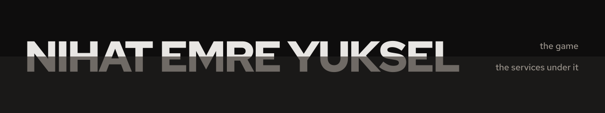

Senior backend engineer in Istanbul. I design and build APIs, cloud services, and multiplayer infrastructure.

TypeScript · Node.js · AWS · DynamoDB · Redis · C# · Unity

**Shipped** [Merlin's Chess](https://www.meta.com/experiences/merlins-chess/8016743778416709/) · [Teleporter: WoG](https://store.steampowered.com/app/1232510/) · [Teleporter](https://store.steampowered.com/app/718810/) · [Love Cubes in the Dark](https://www.youtube.com/watch?v=E91JKUvvTm4)

**2016** Microsoft Summer School, Developer Program · FingerCrack (Top 10 project)

[yuksel.sh](https://yuksel.sh) · [emre@yuksel.sh](mailto:emre@yuksel.sh) · [LinkedIn](https://www.linkedin.com/in/nihatemreyuksel) · [X](https://x.com/nihatemreyuksel)
